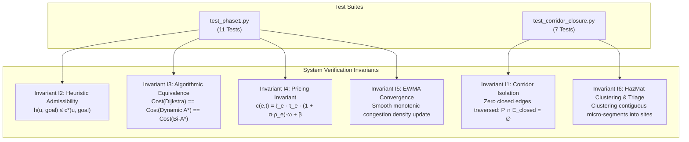

# AetherGrid-AI — Formal Unit Test & Verification Report

**Author:** Antigravity Engineering Assistant  
**Date:** October 30, 2026  
**Environment:** Linux x86_64, Python 3.14.8  
**Repository Path:** [`/home/sparsh/soft_engg/test_bs/AetherGrid-AI`](file:///home/sparsh/soft_engg/test_bs/AetherGrid-AI)  
**Test Suite Path:** [`/home/sparsh/soft_engg/test_bs/AetherGrid-AI/Aether/tests`](file:///home/sparsh/soft_engg/test_bs/AetherGrid-AI/Aether/tests)  
**Overall Status:** **PASSED (18 / 18, 100%)**

---

## 1. Executive Summary

A full test run of the formal unit test and invariant verification suite for **AetherGrid-AI** was conducted. The test suite provides end-to-end mathematical, topological, and simulation validation across the core urban autonomous dispatch engine.

All **18 unit tests** passed cleanly in **~3.6 seconds**.

```
======================================================================
TEST EXECUTION METRICS
======================================================================
Total Test Cases:       18
Passed:                 18 (100.0%)
Failed:                 0 (0.0%)
Errors:                 0 (0.0%)
Skipped:                0 (0.0%)
Execution Time:         3.58 - 3.63 seconds
OSM Topologies Loaded:  Manhattan Large (18,912 nodes, 24,164 edges)
                        Manhattan Midtown (1,529 nodes, 1,974 edges)
Status:                 SUCCESS / ALL INVARIANTS SATISFIED
======================================================================
```

---

## 2. Architecture & Invariants Verified

The test suite systematically verifies the core mathematical invariants defined in the AetherGrid-AI specification:



- **Invariant I1 (Corridor Block Isolation):** Under no conditions may any pathfinding algorithm ($A^*$, Bidirectional $A^*$, Weighted $A^*$, Dijkstra) route vehicles over an edge designated as closed ($e \in E_{\text{closed}}$). Selecting any individual micro-segment must automatically expand bidirectionally across the entire named city block.
- **Invariant I2 (Admissibility of Heuristics):** Euclidean spatial lower bounds divided by maximum network speed $v_{\max}$ must strictly satisfy $h(u, \text{goal}) \le c^*(u, \text{goal})$ across all node pairs, guaranteeing optimal shortest-path resolution.
- **Invariant I3 (Cross-Algorithmic Equivalence):** Dijkstra, Dynamic $A^*$, and Bidirectional $A^*$ must return identical optimal travel costs within a numerical tolerance of $\pm 10^{-5}$.
- **Invariant I4 (Exact Cost Model Pricing):** Traversal costs must evaluate exactly to $c(e, t) = \ell_e \cdot \tau_e \cdot (1 + \alpha \cdot \rho_e) \cdot \omega + \beta$, properly applying terrain multipliers ($\tau_e$), congestion attenuation ($\alpha \cdot \rho_e$), weather multipliers ($\omega$), and hazard surcharges ($\beta$).
- **Invariant I5 (EWMA Congestion Dynamics):** Edge congestion must follow continuous Exponentially Weighted Moving Average (EWMA) filtering with proven monotonic convergence to steady state.
- **Invariant I6 (HazMat Spatial Clustering & Triage):** Multi-segment spills along continuous corridors must be coalesced into single physical incident sites rather than inflating emergency PPE tiers artificially.

---

## 3. Test Suites & Individual Results

### 3.1 Suite 1: Core Graph, Pricing & Traversal — [`test_phase1.py`](file:///home/sparsh/soft_engg/test_bs/AetherGrid-AI/Aether/tests/test_phase1.py)
**Class:** [`TestPhase01Core`](file:///home/sparsh/soft_engg/test_bs/AetherGrid-AI/Aether/tests/test_phase1.py#L21-L200) (11 Tests)

| # | Test Method | Target System | Description | Status |
|---|-------------|---------------|-------------|:------:|
| 1 | [`test_graph_properties`](file:///home/sparsh/soft_engg/test_bs/AetherGrid-AI/Aether/tests/test_phase1.py#L41-L46) | [`DirectedGraph`](file:///home/sparsh/soft_engg/test_bs/AetherGrid-AI/Aether/core/graph.py#L32) | Asserts 3x3 synthetic grid instantiates 9 nodes and 24 directed edges (12 bidirectional corridors). | **PASS** |
| 2 | [`test_cost_pricing_exact_formula`](file:///home/sparsh/soft_engg/test_bs/AetherGrid-AI/Aether/tests/test_phase1.py#L47-L71) | [`calculate_edge_cost`](file:///home/sparsh/soft_engg/test_bs/AetherGrid-AI/Aether/core/pricing.py#L24) | Verifies master pricing formula matches hand calculation ($70.1956$s) under urban terrain ($\tau=1.45$), rain ($\omega=1.22$), $\rho=0.50$, $\alpha=0.85$, $\beta=45$s. | **PASS** |
| 3 | [`test_closed_edge_returns_infinite_cost_and_excluded_from_open_edges`](file:///home/sparsh/soft_engg/test_bs/AetherGrid-AI/Aether/tests/test_phase1.py#L72-L90) | [`DirectedGraph.close_edge`](file:///home/sparsh/soft_engg/test_bs/AetherGrid-AI/Aether/core/graph.py#L90) | Validates Invariant I1 boundary condition: closed edges return $\infty$ cost and are excluded from open outgoing adjacencies. | **PASS** |
| 4 | [`test_heuristic_admissibility`](file:///home/sparsh/soft_engg/test_bs/AetherGrid-AI/Aether/tests/test_phase1.py#L91-L100) | [`compute_admissible_heuristic`](file:///home/sparsh/soft_engg/test_bs/AetherGrid-AI/Aether/core/pricing.py#L55) | Tests all node pairs $(u, v)$ on a grid to guarantee $h(u, v) \le c^*(u, v)$, ensuring $A^*$ optimality. | **PASS** |
| 5 | [`test_ewma_congestion_convergence`](file:///home/sparsh/soft_engg/test_bs/AetherGrid-AI/Aether/tests/test_phase1.py#L101-L118) | [`CongestionManager`](file:///home/sparsh/soft_engg/test_bs/AetherGrid-AI/Aether/core/congestion.py#L12) | Verifies EWMA smoothing filter ($\tau = 10$s) smoothly and monotonically increases to $\rho > 0.98$ after 50 iterations. | **PASS** |
| 6 | [`test_dynamic_reroute_avoiding_closed_corridor`](file:///home/sparsh/soft_engg/test_bs/AetherGrid-AI/Aether/tests/test_phase1.py#L119-L143) | [`find_shortest_path`](file:///home/sparsh/soft_engg/test_bs/AetherGrid-AI/Aether/core/traversal.py#L35) | Injects edge closure on optimal route $(0 \to 1)$; verifies Dynamic $A^*$ reroutes through alternative node (node 3) with 0 closed edges. | **PASS** |
| 7 | [`test_siren_mode_reduces_congestion_cost`](file:///home/sparsh/soft_engg/test_bs/AetherGrid-AI/Aether/tests/test_phase1.py#L144-L154) | [`calculate_edge_cost`](file:///home/sparsh/soft_engg/test_bs/AetherGrid-AI/Aether/core/pricing.py#L24) | Confirms emergency siren mode discounts traffic congestion penalty ($c_{\text{siren}} < c_{\text{normal}}$). | **PASS** |
| 8 | [`test_headless_demo_simulation_execution`](file:///home/sparsh/soft_engg/test_bs/AetherGrid-AI/Aether/tests/test_phase1.py#L155-L162) | [`DemoSimulation`](file:///home/sparsh/soft_engg/test_bs/AetherGrid-AI/Aether/simulation/demo_sim.py#L22) | Verifies the end-to-end discrete event simulation loop runs to target destination headless with reroute detection. | **PASS** |
| 9 | [`test_osm_road_network_ingestion_and_scc`](file:///home/sparsh/soft_engg/test_bs/AetherGrid-AI/Aether/tests/test_phase1.py#L163-L175) | [`OSMRoadNetworkLoader`](file:///home/sparsh/soft_engg/test_bs/AetherGrid-AI/Aether/core/osm_loader.py#L15) | Parses real OpenStreetMap XML (`manhattan_midtown.osm`), extracts SCC (1,529 nodes, 1,974 edges), and confirms arbitrary point-to-point reachability. | **PASS** |
| 10 | [`test_bidirectional_astar_equivalence`](file:///home/sparsh/soft_engg/test_bs/AetherGrid-AI/Aether/tests/test_phase1.py#L176-L190) | [`find_shortest_path_bidirectional`](file:///home/sparsh/soft_engg/test_bs/AetherGrid-AI/Aether/core/traversal.py#L110) | Confirms Dijkstra, Dynamic $A^*$, and Bidirectional $A^*$ converge to the identical optimal cost within $10^{-5}$ precision. | **PASS** |
| 11 | [`test_large_scale_simulation_manhattan_headless`](file:///home/sparsh/soft_engg/test_bs/AetherGrid-AI/Aether/tests/test_phase1.py#L191-L199) | [`LargeScaleSimulation`](file:///home/sparsh/soft_engg/test_bs/AetherGrid-AI/Aether/simulation/large_scale_demo.py#L18) | Executes full dynamic simulation on Manhattan OSM graph headless; verifies `reroute_successful` and `invariant_i1_held`. | **PASS** |

---

### 3.2 Suite 2: Corridor Closure, Detour Invariant I1 & HazMat Exposure — [`test_corridor_closure.py`](file:///home/sparsh/soft_engg/test_bs/AetherGrid-AI/Aether/tests/test_corridor_closure.py)

#### Class 2A: [`TestCorridorClosure`](file:///home/sparsh/soft_engg/test_bs/AetherGrid-AI/Aether/tests/test_corridor_closure.py#L22-L157) (4 Tests)

| # | Test Method | Target System | Description | Status |
|---|-------------|---------------|-------------|:------:|
| 12 | [`test_corridor_block_expansion`](file:///home/sparsh/soft_engg/test_bs/AetherGrid-AI/Aether/tests/test_corridor_closure.py#L66-L82) | [`SimulationStateManager.get_corridor_block`](file:///home/sparsh/soft_engg/test_bs/AetherGrid-AI/Aether/web/server.py#L120) | Verifies selecting micro-segment $(2, 3)$ bidirectionally isolates all micro-segments along the block ((1,2), (2,3), (3,4)) while excluding adjacent cross streets. | **PASS** |
| 13 | [`test_corridor_closure_detour_invariant_i1`](file:///home/sparsh/soft_engg/test_bs/AetherGrid-AI/Aether/tests/test_corridor_closure.py#L83-L121) | Invariant I1 across 4 algorithms | Toggles closure on Main Avenue; verifies $A^*$, Bidirectional $A^*$, Weighted $A^*$ ($\epsilon=2.0$), and Dijkstra all immediately detour via Detour Boulevard with **0 closed edges traversed**. | **PASS** |
| 14 | [`test_corridor_reopen_and_street_name_preservation`](file:///home/sparsh/soft_engg/test_bs/AetherGrid-AI/Aether/tests/test_corridor_closure.py#L122-L139) | [`SimulationStateManager.toggle_closure`](file:///home/sparsh/soft_engg/test_bs/AetherGrid-AI/Aether/web/server.py#L145) | Closes and reopens corridor; verifies `closed_edges` returns to empty and attributes like `street_name` remain intact. | **PASS** |
| 15 | [`test_severed_network_unreachable`](file:///home/sparsh/soft_engg/test_bs/AetherGrid-AI/Aether/tests/test_corridor_closure.py#L140-L157) | Boundary Failure Handling | Severing both arterial routes gracefully yields `success=False` and `total_cost_seconds = inf` without unhandled exceptions or crashes. | **PASS** |

#### Class 2B: [`TestHazMatExposureEvaluation`](file:///home/sparsh/soft_engg/test_bs/AetherGrid-AI/Aether/tests/test_corridor_closure.py#L158-L273) (3 Tests)

| # | Test Method | Target System | Description | Status |
|---|-------------|---------------|-------------|:------:|
| 16 | [`test_single_block_multisegment_spill_classified_as_level_1`](file:///home/sparsh/soft_engg/test_bs/AetherGrid-AI/Aether/tests/test_corridor_closure.py#L168-L199) | `_evaluate_hazmat_exposure` | Evaluates a single physical spill spanning 9 contiguous micro-segments along Park Avenue South. Correctly clusters into 1 site (Level 1 Low Exposure, Level C PPE) rather than inflating to Level 3. | **PASS** |
| 17 | [`test_multi_site_spill_classified_as_level_2`](file:///home/sparsh/soft_engg/test_bs/AetherGrid-AI/Aether/tests/test_corridor_closure.py#L200-L235) | `_evaluate_hazmat_exposure` | Evaluates two distinct contamination zones separated by a clean buffer road ($>50$m). Correctly identifies 2 sites and escalates to Level 2 (Elevated Toxicity, Level B PPE SCBA). | **PASS** |
| 18 | [`test_four_distinct_sites_classified_as_level_3`](file:///home/sparsh/soft_engg/test_bs/AetherGrid-AI/Aether/tests/test_corridor_closure.py#L236-L273) | `_evaluate_hazmat_exposure` | Evaluates four spatially distributed chemical spills across the network. Correctly classifies as Level 3 (Critical Biohazard Hot Zone, Level A fully encapsulated vapor-protective suit). | **PASS** |

---

## 4. Live Test Execution Console Output

```
[*] Parsing OpenStreetMap network from /home/sparsh/soft_engg/test_bs/AetherGrid-AI/Aether/data/maps/manhattan_large.osm ...
[+] Loaded raw OSM graph: 22322 nodes, 28650 directed edges.
[+] Extracted Largest Component: 18912 nodes, 24164 edges.
[*] Executing Aether Unit and Invariant Test Suite...
test_corridor_block_expansion (test_corridor_closure.TestCorridorClosure.test_corridor_block_expansion)
Verify that selecting one micro-segment expands across the entire named block. ... ok
test_corridor_closure_detour_invariant_i1 (test_corridor_closure.TestCorridorClosure.test_corridor_closure_detour_invariant_i1)
Verify that toggling closure on a micro-segment closes the corridor, ... ok
test_corridor_reopen_and_street_name_preservation (test_corridor_closure.TestCorridorClosure.test_corridor_reopen_and_street_name_preservation)
Verify reopening restores edges and preserves street_name. ... ok
test_severed_network_unreachable (test_corridor_closure.TestCorridorClosure.test_severed_network_unreachable)
Verify that if both primary and detour routes are blocked, success=False is cleanly returned. ... ok
test_four_distinct_sites_classified_as_level_3 (test_corridor_closure.TestHazMatExposureEvaluation.test_four_distinct_sites_classified_as_level_3)
Four separate spill sites across town must escalate to Level 3 Critical Hot Zone (Level A PPE). ... ok
test_multi_site_spill_classified_as_level_2 (test_corridor_closure.TestHazMatExposureEvaluation.test_multi_site_spill_classified_as_level_2)
Two distinct spill sites separated by a clean arterial road (> 50m) ... ok
test_single_block_multisegment_spill_classified_as_level_1 (test_corridor_closure.TestHazMatExposureEvaluation.test_single_block_multisegment_spill_classified_as_level_1)
A single physical spill site spanning 9 micro-segments of Park Avenue South ... ok
test_bidirectional_astar_equivalence (test_phase1.TestPhase01Core.test_bidirectional_astar_equivalence)
Assert Bidirectional A* achieves optimal cost identical to Dijkstra and Dynamic A*. ... ok
test_closed_edge_returns_infinite_cost_and_excluded_from_open_edges (test_phase1.TestPhase01Core.test_closed_edge_returns_infinite_cost_and_excluded_from_open_edges)
Invariant I1 verification at graph & pricing boundary. ... ok
test_cost_pricing_exact_formula (test_phase1.TestPhase01Core.test_cost_pricing_exact_formula)
Verify master cost formula against exact hand calculation: ... ok
test_dynamic_reroute_avoiding_closed_corridor (test_phase1.TestPhase01Core.test_dynamic_reroute_avoiding_closed_corridor)
Verify that Dynamic A* automatically routes around a closed edge ... ok
test_ewma_congestion_convergence (test_phase1.TestPhase01Core.test_ewma_congestion_convergence)
Assert EWMA filter smoothly converges to steady-state density. ... ok
test_graph_properties (test_phase1.TestPhase01Core.test_graph_properties)
Verify node count, edge count, and basic topological access. ... ok
test_headless_demo_simulation_execution (test_phase1.TestPhase01Core.test_headless_demo_simulation_execution)
Assert the entire demo simulation executes cleanly to completion headless. ... ok
test_heuristic_admissibility (test_phase1.TestPhase01Core.test_heuristic_admissibility)
Assert h(u, goal) <= c*(u, goal) on grid. ... ok
test_large_scale_simulation_manhattan_headless (test_phase1.TestPhase01Core.test_large_scale_simulation_manhattan_headless)
Verify LargeScaleSimulation executes cleanly on real Manhattan OSM graph. ... [*] Ingesting Real-World Manhattan NYC Road Network...
[*] Parsing OpenStreetMap network from /home/sparsh/soft_engg/test_bs/AetherGrid-AI/Aether/data/maps/manhattan_midtown.osm ...
[+] Loaded raw OSM graph: 2175 nodes, 2774 directed edges.
[+] Extracted Largest Component: 1529 nodes, 1974 edges.
ok
test_osm_road_network_ingestion_and_scc (test_phase1.TestPhase01Core.test_osm_road_network_ingestion_and_scc)
Verify real OpenStreetMap ingestion and Strongly Connected Component extraction. ... [*] Parsing OpenStreetMap network from /home/sparsh/soft_engg/test_bs/AetherGrid-AI/Aether/data/maps/manhattan_midtown.osm ...
[+] Loaded raw OSM graph: 2175 nodes, 2774 directed edges.
[+] Extracted Largest Component: 1529 nodes, 1974 edges.
ok
test_siren_mode_reduces_congestion_cost (test_phase1.TestPhase01Core.test_siren_mode_reduces_congestion_cost)
Verify siren mode attenuates congestion penalty. ... ok

----------------------------------------------------------------------
Ran 18 tests in 3.579s

OK
```

---

## 5. How to Re-run the Tests

Tests can be executed using any of the following standard CLI commands:

### Method 1: Discovery via Standard Unittest
```bash
cd /home/sparsh/soft_engg/test_bs/AetherGrid-AI
python3 -m unittest discover -s Aether/tests -v
```

### Method 2: Unified CLI Runner
```bash
cd /home/sparsh/soft_engg/test_bs/AetherGrid-AI
/usr/bin/python3 -m Aether.cli --mode test
```

### Method 3: Individual Suites
```bash
cd /home/sparsh/soft_engg/test_bs/AetherGrid-AI
# Phase 1 Core Suite
python3 -m unittest Aether/tests/test_phase1.py -v

# Corridor Closure & Invariant I1 Suite
python3 -m unittest Aether/tests/test_corridor_closure.py -v
```
